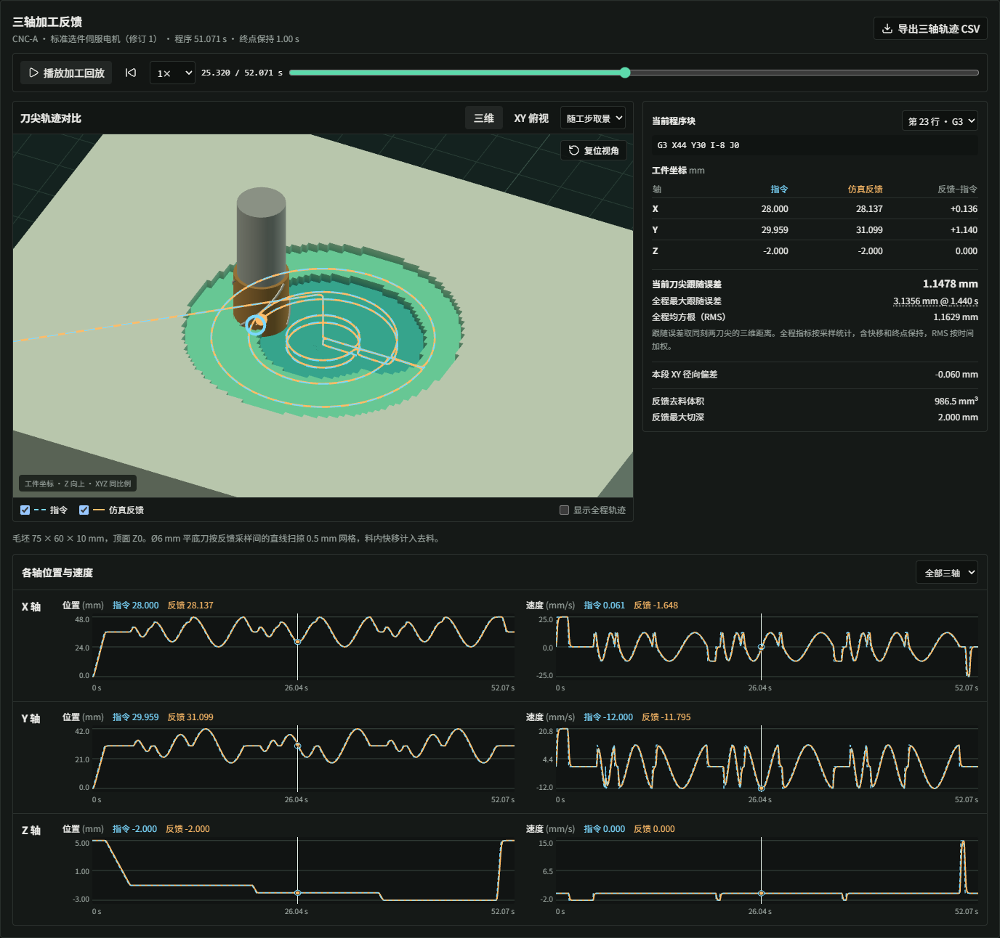

# 用自组电机驱动 CNC-A 铣三层圆槽

打开示例，在 **三轴装机** 核对 X、Y、Z 三个安装位的电机型号和修订。运行后，在 **当前程序块** 选 **第 23 行 · G3**，就能看到刀具在第二层绕圆，旁边的三轴曲线会跳到同一时刻。[打开 CNC-A 三轴加工工作台](https://lusipad.com/omg/?view=workbench&example=cnc-factory&contour=cnc-a)



## 把同一型号装到三根轴

1. 如果当前工程的 CNC-A 已经在 X 轴装了自己组建的兼容电机，示例会沿用这台电机的修订。若 X 轴还没有可求解的电机，库中只有一个兼容修订时会自动选用，有多个时可在 **三轴共用电机型号与修订** 中选择。已有机床或自组电机但缺少兼容件时，工作台会指出需要补齐的装机条件。空白工程会用教学组合 `标准选件伺服电机 @ 1`，每台含 `S40-STD` 定子、`R40-STD` 转子和两只 `B08-STD` 轴承。[从定子、转子和轴承组建电机](零件装配伺服电机.md)
2. 查看三个轴卡片上的安装路径。需要变更时，选电机修订和新的机床修订，点 **装入三轴并运行**。已经装齐时点 **运行 G 代码**。三台电机引用同一份型号定义，各自求解绕组电流、转子角度和转速。[三轴安装定义](../public/assemblies/cnc-factory/contour-template.device.json) · [标准电机定义](../public/assemblies/cnc-factory/contour-motor.device.json)
3. 示例里的装机、程序编辑和运行都在试用副本中完成。点 **加入当前工程** 才写入本机工程。如果已有同名工厂，工作台会列出需要确认的替换配置。

## 圆槽程序与装夹

毛坯为 75 × 60 × 10 mm，顶面取工件 Z0。工件原点在机床坐标 `(20, 20, −15) mm`，刀尖从工件坐标 `(0, 0, 5) mm` 起步。程序以 `F120` 下刀到 Z−1、−2、−3 mm 三层，以 `F720` 从圆心 `(36, 30) mm` 向外清料。最外圈刀心半径 12 mm，加上平底刀半径 3 mm，名义槽径为 30 mm。完整程序含 27 个运动段，其中 4 段 G2、6 段 G3。点 **编辑 G 代码** 可修改、导入文件或恢复预置。[下载完整圆槽 G 代码](../public/assemblies/cnc-factory/circular-pocket.nc)

第一层走到 `(44, 30, −1) mm` 后，下面三行先顺时针走半径 8 mm 的整圆，再沿 X 向外进给，逆时针走半径 12 mm 的整圆。程序使用 `G17` 选择 XY 平面，从 Z 正方向看向工件判断顺逆时针。`I` 和 `J` 给出圆心相对于该段起点的偏移。[LinuxCNC 的 G2/G3 圆弧约定](https://www.linuxcnc.org/docs/stable/html/gcode/g-code.html#gcode:g2-g3)

```gcode
G2 X44 Y30 I-8 J0
G1 X48
G3 X48 Y30 I-12 J0
```

| CNC-A 教学工况 | X | Y | Z |
| --- | ---: | ---: | ---: |
| 机床坐标行程（mm） | 0 至 250 | 0 至 180 | −100 至 0 |
| 进给上限（mm/min） | 1500 | 1500 | 900 |
| 加速度上限（mm/s²） | 180 | 180 | 90 |

三根轴的丝杠导程均为 5 mm/转，移动质量均为 5 kg。驱动器的 q 轴电压限幅为 24 V，电流指令上限为 4 A，转速指令上限为 2500 rpm。Z 轴采用理想重力平衡。Modelica 按实际装入的定子、转子和两只轴承的参数计算反馈，毛坯按反馈刀位在 0.5 mm 网格上做几何去料，料内快移也会扫去材料。当前动力学忽略切削反力。[跟踪轴 Modelica 方程](../public/modelica/GouyuanContour.mo)

## 在同一时刻读指令和反馈

点 **播放加工回放** 或拖动时间条。三维图和 **XY 俯视** 都用同一工件坐标显示指令虚线与仿真反馈实线。各轴的位置单位为 mm，速度单位为 mm/s。标准组合在 **25.320 s** 走到第 23 行的 G3 中圈，对应上图。

| 轴 | 指令位置（mm） | 反馈位置（mm） | 指令速度（mm/s） | 反馈速度（mm/s） |
| --- | ---: | ---: | ---: | ---: |
| X | 28.000 | 28.137 | +0.061 | −1.648 |
| Y | 29.959 | 31.099 | −12.000 | −11.795 |
| Z | −2.000 | −2.000 | 0.000 | 0.000 |

**刀尖跟随误差** 是同一时刻指令点与反馈点的三维距离，此刻为 **1.1478 mm**。**本段 XY 径向偏差** 取反馈点到当前圆心的平面距离减去指令半径，此刻为 **−0.0602 mm**，刀心位于名义圆内侧。两个读数可同时反映沿轨迹的滞后和偏离圆周的程度。

这段程序运行 **51.071 s**，然后在 `(36, 30, 5) mm` 保持指令 **1 s**。全程采样的最大跟随误差为 **3.1356 mm**，发生在 **1.440 s**、第 5 行 `G0 X36 Y30` 快移时，刀尖在毛坯上方 5 mm。点最大值可定位该行。含快移与终点保持的时间加权均方根为 **1.1629 mm**。

把三台电机的转子惯量从 2 × 10⁻⁵ 换成 6 × 10⁻⁵ kg·m²，重复相同程序，各轴反馈位置相对标准组合的最大变化为 **0.22395 mm**，反馈速度最大变化为 **1.83002 mm/s**。可用 **导出三轴轨迹 CSV** 按时刻比较自己的两次运行。[标准圆槽与换转子实算记录](../scripts/modelica/contour-export-results.json)

## 用 OpenModelica 独立复算

运行后点 **导出三轴 Modelica ZIP**。解压并在根目录用 OpenModelica 1.27.2、Modelica 标准库 4.0.0 执行 `omc run.mos`，结果写入 `ContourRun_res.csv`。`program.nc` 保存本次 G 代码，`contour.twin.json` 保存装机工程，`contour-map.json` 记录三条安装路径和各参数的来源。`reference.txt` 按 1 ms 间隔并补入精确程序段终点，为原生模型提供和浏览器相同的位置参考。网页轨迹 CSV 按 10 ms 和段端记录，可按 `time_s` 与原生 `time` 对齐至映射中的 `reference.endS`。DASSL 在段端事件前后可能输出同一时刻的两行。

在源码仓库复核两端结果，可用已安装的 Chromium 和 `omc` 运行以下命令。脚本分别试算标准圆槽、只换高惯量转子、改变起始工件坐标的螺旋插补，结果保存在输出目录的 `contour-export-comparison.json`。标准圆槽的 5,236 个网页观测时刻均与原生 DASSL 输出配对，三轴反馈位置的最大差小于 0.000017 mm，速度最大差小于 0.00016 mm/s。[浏览器导出脚本](../scripts/modelica/prepare-contour-exports.ts) · [原生复算与比较脚本](../scripts/modelica/verify-contour-exports.py)

```bash
npx tsx scripts/modelica/prepare-contour-exports.ts dist/contour-check
python scripts/modelica/verify-contour-exports.py --out dist/contour-check
```
