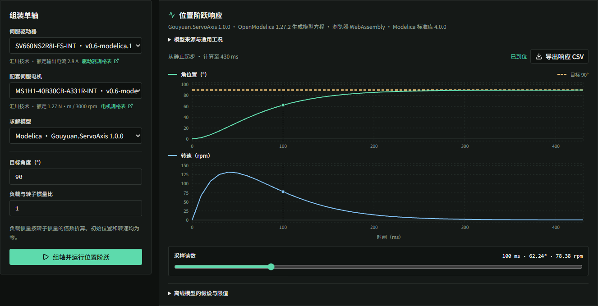

# 用 Modelica 运行一根汇川伺服轴

这份工程用汇川 SV660NS2R8I-FS-INT 驱动器和 MS1H1-40B30CB-A331R-INT 无抱闸电机，计算从静止零位转向目标角度时的位置和转速。两个设备包都使用平台修订 `v0.6-modelica.1`，保留了原 `v0.6` 修订的厂家来源与额定值，并各自声明了绑定的模型。工程中的 `servoAxis.modelRef` 锁定 `Gouyuan.ServoAxis` 和版本 `1.0.0`。[打开工程预览](https://lusipad.com/omg/?view=resources&source=modelica/servo-axis.twin.json) · [下载工程 JSON](https://lusipad.com/omg/modelica/servo-axis.twin.json)

## 运行 90°，再反向运行 −45°

1. 从 **示例库 → 汇川伺服轴** 直接试跑。示例在独立工作区运行，点击 **加入当前工程** 可保存所选配置。若要导入整份工程，打开工程预览，核对替换范围并确认。在 **装配与仿真** 中打开伺服轴。[试跑汇川伺服轴](https://lusipad.com/omg/?view=workbench&example=inovance-servo)
2. 在 **求解模型** 中选 **Modelica · Gouyuan.ServoAxis 1.0.0**，保持目标角度 **90°**、负载与转子惯量比 **1**，点击 **组轴并运行位置阶跃**。上图读取轴的位置，下图读取转速。拖动 **采样读数** 的时间游标，可核对同一时刻的角度与转速。点 **导出响应 CSV** 可保存各采样时刻的数据。
3. 将目标改为 **−45°**，重新运行。每次都从静止零位起步，负角度表示反转。也可将负载惯量比从 1 改为 5，保持相同指令，比较相同时刻的响应。
4. 从工程文件菜单导出工程 JSON，随后可以通过 **工程资源 → 选择文件** 打开副本。设备身份、所选模型版本、目标角度和负载惯量比随工程保存。

### 核对 100 ms 的读数

下表取自 OpenModelica 原生 DASSL 求解。归档回归的反向工况为 −90°，表中的 −45° 使用同一模型另行复算。浏览器的响应 CSV 包含 `time_ms`、`target_deg`、`position_deg` 和 `speed_rpm` 四列。打开对应工况的 CSV，找到 `time_ms = 100` 的那一行，对照位置和转速。

| 位置指令 | 负载与转子惯量比 | 100 ms 位置 | 100 ms 转速 |
| ---: | ---: | ---: | ---: |
| +90° | 1 | 62.2403° | 78.3803 rpm |
| −45° | 1 | −31.1202° | −39.1902 rpm |
| +90° | 5 | 46.9177° | 103.5139 rpm |



浏览器使用 OpenModelica 对这根轴展开、消元后生成的标量 C 方程，编译为 WebAssembly 后用 0.05 ms 固定步长的四阶 Runge–Kutta 方法积分。每 10 ms 记录一次曲线，位置误差在 ±0.1°、转速在 ±0.5 rpm 以内连续保持 50 ms 时记录最后一个点并结束，最长运行 8 s。原生 DASSL 基准保存完整的 8 s，核对网页 CSV 时按相同时间点对齐。要检查下载的源码，可执行 `sha256sum Gouyuan.mo`，将输出与清单中的 `sourceSha256` 对照。[浏览器产物与源码 SHA-256 清单](https://lusipad.com/omg/modelica/runtime/manifest.json)

## 从已有设备包组轴

在空白工程的 **工程资源** 同时选择下面两份设备包并核对安装，再进入伺服轴的组装区。选择上述驱动器和电机的 `v0.6-modelica.1` 修订，指定 Modelica 模型，填写目标角与负载惯量比并运行。设备包中的 `servo.kind` 区分驱动和电机，电机的兼容驱动清单给出实际可配对型号。[下载绑定驱动模型的设备包](https://lusipad.com/omg/modelica/devices/SV660NS2R8I-FS-INT.device.json) · [下载绑定电机模型的设备包](https://lusipad.com/omg/modelica/devices/MS1H1-40B30CB-A331R-INT.device.json)

在两个新包的 `servo.modelRef` 中，可直接查看 `Gouyuan.PositionDrive` 与 `Gouyuan.RatedTorqueMotor` 的绑定，两者都是 1.0.0。设备库可以同时安装同型号的原始 `v0.6` 和新修订。若已装原始设备包，也可手动选择 Modelica 整轴模型，工作台按已配对的驱动、电机角色进行兼容绑定。[下载 Gouyuan.mo 查看具名模型](https://lusipad.com/omg/modelica/Gouyuan.mo) · [角色、字段与单位映射](https://lusipad.com/omg/modelica/library.json)

项目使用 Modelica Standard Library 4.0.0 的部件。标准库版权归 Modelica Association and contributors，采用 BSD 3-Clause 许可证。[标准库固定修订](https://github.com/modelica/ModelicaStandardLibrary/tree/6626538a236a34a390655b55d5e8c906bfe31772) · [随发布物提供的许可证原文](https://lusipad.com/omg/modelica/MSL-LICENSE.txt)

## 设备规格与模型假设

| 数据来源 | 本工程使用的信息 |
| --- | --- |
| 汇川驱动器选型表 | 额定电流 2.8 A，峰值电流 10.1 A。 |
| 汇川无抱闸电机选型表 | 400 W，额定与峰值转矩 1.27、4.45 N·m，额定与最高转速 3000、7000 rpm。转子惯量 0.145 × 10⁻⁴ kg·m²。 |
| 工作台设定 | 刚性负载与转子同轴。负载惯量比 1 表示负载惯量等于转子惯量，总惯量为 2.90 × 10⁻⁵ kg·m²。位置、速度反馈的固定增益按参考负载比 1 和自然角频率 24 rad/s 设置。 |

两设备包保留了原始选型表中的配套行、型号选项和页码。该行的 2.8 A 是驱动器额定值。此电机包没有单列额定电流，示例在模型换算时以配套驱动器的 2.8 A 代入，作为对配对额定工况的假设。[汇川 SV660N 选型表第 3 页](https://www.inovance.eu/fileadmin/downloads/Brochures/EN/SV660N_FIyer_Spreads_Web_EN_v0.6.pdf#page=3)

驱动模型根据位置误差和速度反馈计算电流指令，额定转速限制速度指令，额定电流限制电流指令。电机按额定转矩与额定电流之比换算平均转矩，再按连续额定转矩与功率限幅。标准库的一维转动惯量、法兰和传感器提供机械响应。峰值额定值留在设备资料中备查。绕组电阻、电感、磁链、功率开关与厂家控制整定需要另外的数据才能复现。比较具体机器的整定和跟随误差时，还需负载、摩擦、传动柔性和现场轨迹。[标准库转动惯量说明](https://doc.modelica.org/Modelica%204.0.0/Resources/helpWSM/Modelica/Modelica.Mechanics.Rotational.Components.Inertia.html)

## 用 OpenModelica 原生复算

在 Ubuntu 24.04 amd64 或对应的 WSL 环境，从仓库根目录运行以下命令。安装脚本需要系统已有 GCC/G++、Clang、CMake、Make 和发行版软件包索引。它将 OpenModelica 1.27.2 与 Modelica Standard Library 4.0.0 放入指定目录。已有相同版本的工具链时，可直接运行最后一行，指定本机编译器及可写的输出目录。

```bash
bash scripts/modelica/bootstrap-linux.sh /tmp/omg-openmodelica-1.27.2 /tmp/omg-modelica-downloads
source /tmp/omg-openmodelica-1.27.2/env.sh
python3 scripts/modelica/verify.py --omc /tmp/omg-openmodelica-1.27.2/bin/omc --out /tmp/gouyuan-modelica-check
```

打开 `public/modelica/Gouyuan.mo`，可逐项检查驱动电流指令、电机平均转矩、刚性负载连接及 `angleDeg`、`speedRpm`、`torqueNm` 三个输出。整轴的实验从 0 s 至 8 s，输出间隔 0.01 s。回归脚本通过 MOS 调用原生编译器，保存可执行模型的日志、采样文件与比较结果。[编译环境脚本](../scripts/modelica/bootstrap-linux.sh) · [原生 MOS](../scripts/modelica/check-build.mos) · [复算脚本](../scripts/modelica/verify.py) · [已执行的原生回归记录](../scripts/modelica/native-results.json)

要从源码核对浏览器产物，在同一工具环境中准备 Clang、`wasm-ld` 18.1.3 和 Node.js。Ubuntu 24.04 的对应软件包为 `clang-18` 和 `lld-18`。如果工具装在独立目录，可通过 `CLANG` 和 `WASM_LD` 指定可执行文件的绝对路径。以下两步先重新生成 WebAssembly 并逐字节对比发布文件，再与上一步保存的原生轨迹对照。

```bash
python3 scripts/modelica/build-web.py --check
node scripts/modelica/compare-web.mjs /tmp/gouyuan-modelica-check
```

对照脚本会在结果目录生成 `web-comparison.json`，列出 11 个伺服工况在完整 8 s 内的最大绝对误差。每个工况按 10 ms 间隔核对 801 个时刻，角度、转速、转矩容差依次为 0.005°、0.02 rpm、0.00002 N·m。[对照脚本](../scripts/modelica/compare-web.mjs)

若要单独执行 MOS，可以在加载好工具环境的终端中，用一份新目录检查刚下载的原始模型。下面的 `modelica_repo` 指向仓库根目录，`modelica_work` 中会生成原生可执行文件。

```bash
modelica_repo="$PWD"
modelica_work="$(mktemp -d)"
cp public/modelica/Gouyuan.mo "$modelica_work/"
cd "$modelica_work"
omc "$modelica_repo/scripts/modelica/check-build.mos"
./Gouyuan.ServoAxis -noEventEmit -override=targetDeg=-45,loadInertiaRatio=1 -r=reverse45.csv
```

`reverse45.csv` 的 `time` 列以秒计。在 `time = 0.1` 处读取 `angleDeg` 和 `speedRpm`，即可对照上表中的负向工况。
