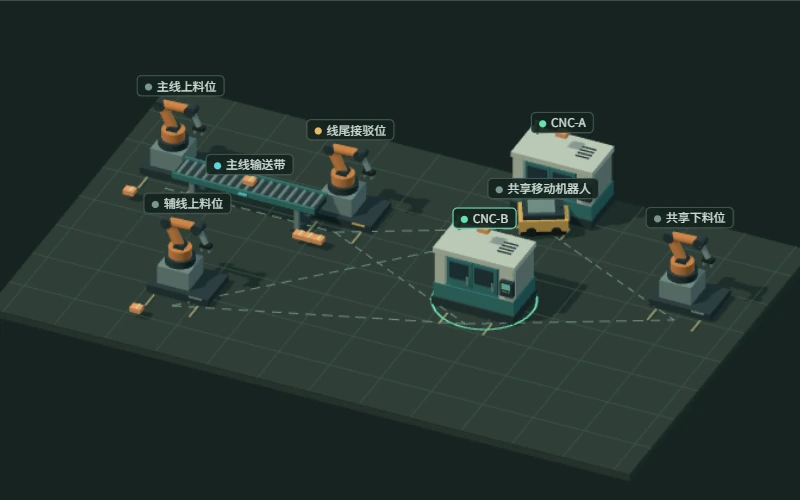

# 从 BOM 搭建双线数控车间

打开示例后，将回放时间移到 **30 s**。此时 CNC-A 正在加工主线第 1 件，CNC-B 正在加工补料线第 1 件。点选机床、输送带或移动机器人，可以在同一时刻核对各台设备的任务。示例内可以试装和换型，点击 **加入当前工程** 后才保存到本机工程。[试跑双线数控车间](https://lusipad.com/omg/?view=workbench&example=cnc-factory) · [预览整份工程](https://lusipad.com/omg/?view=resources&source=assemblies/cnc-factory/project.twin.json)



## 从空工程逐步装配

1. 在 **工程资源** 导入 BOM。8 行列出上下料单元、输送带、移动机器人和机床的可选型号与数量。库存按安装的设备实例计数，每加工一件工件仍使用同一台设备。[下载 BOM](https://lusipad.com/omg/assemblies/cnc-factory/bom.csv)
2. 在同一入口导入设备库并确认安装。库中有 8 种整机和 105 种可复用的内部部件修订。也可逐个导入下表的整机包，再补装共享子件库。遇到同型号的多个修订，按工程指定的版本核对采购行绑定。[下载完整设备库](https://lusipad.com/omg/assemblies/cnc-factory/devices.library.json) · [下载共享子件库](https://lusipad.com/omg/assemblies/cnc-factory/parts.library.json)
3. 导入工厂布局并运行。布局保存设备实例、安装位置、两条线的投料计划、工序顺序、候选机床和载具。也可以在工厂编辑器中新建布局，按下表放置设备，再逐条添加工序。[下载工厂布局](https://lusipad.com/omg/assemblies/cnc-factory/layout.factory.json)

| 设备与坐标（米） | 当前实例采用的设备包 | 可替换设备包 |
| --- | --- | --- |
| 主线上料位 `(0, 0)`、辅线上料位 `(2, −4)`、共享下料位 `(12, 0)` | [标准上下料单元，每件 4 s](https://lusipad.com/omg/assemblies/cnc-factory/devices/handler-standard.device.json) | [快速上下料单元，每件 2 s](https://lusipad.com/omg/assemblies/cnc-factory/devices/handler-fast.device.json) |
| 线尾接驳位 `(4, 0)` | 快速上下料单元 | 标准上下料单元 |
| 主线输送带 `(2, 0)` | [标准输送带，1 m/s](https://lusipad.com/omg/assemblies/cnc-factory/devices/belt-standard.device.json) | [快速输送带，2 m/s](https://lusipad.com/omg/assemblies/cnc-factory/devices/belt-fast.device.json) |
| 共享移动机器人，初始在 `(4, −2)` | [标准车，载货 1 m/s](https://lusipad.com/omg/assemblies/cnc-factory/devices/amr-standard.device.json) | [快速车，载货 1.8 m/s](https://lusipad.com/omg/assemblies/cnc-factory/devices/amr-fast.device.json) |
| CNC-A `(8, 2)` | [定节拍机床，每件 60 s](https://lusipad.com/omg/assemblies/cnc-factory/devices/cnc-cycle.device.json) | [进给节拍机床，每件 36 s](https://lusipad.com/omg/assemblies/cnc-factory/devices/cnc-feed.device.json) |
| CNC-B `(8, −2)` | 进给节拍机床 | 定节拍机床 |

手工搭建时，从 **装配与仿真 → 新建装配** 进入 **工厂与生产线**。在 **设备布局** 中选择设备包，点 **添加设备**，填写实例名称与 X、Y 坐标。相同包可添加为多台独立设备。在 **产线工序** 中点 **添加产线**，填写批量和投料间隔，再通过 **添加工序** 逐步选择候选工位。从第二道工序开始，可选择将工件送入本站的运输设备。同一工序勾选两台机床表示并行候选，一件工件会派给其中一台。[打开工厂编辑器](https://lusipad.com/omg/?view=workbench&target=factory-new)

主加工线从 0 s 起每 5 s 释放一件，共 6 件。主线上料位完成上料，输送带将工件沿 4 m 的固定路段送到线尾接驳位。接驳完成后，移动机器人将工件送给候选机床 CNC-A 或 CNC-B，加工完成再由同一辆车送往共享下料位。

补料线从 0 s 起每 17 s 释放一件，共 3 件。第一道工序使用辅线上料位，第二、三道工序分别加工和下料。加工工序勾选同一组 CNC-A、CNC-B，两段搬运都选择同一个移动机器人实例。这样两条产线会竞争实际建在车间中的一辆车和两台机床。

## 读懂一件工件的等待和运输

在回放中点选设备后，点 **拆解此设备** 可查看该实例当前安装的内部修订，再切回 **工厂回放** 继续观察同一时刻。单台设备、整条线与整厂都可以汇总最小件数量。[直接打开 CNC-A 的结构](https://lusipad.com/omg/?view=workbench&example=cnc-factory&structure=cnc-a) · [结构修订与换件教程](设备分解.md)

主线第 1 件在 **10.00 s** 完成接驳。此时机器人正在为补料线服务。机器人在 **14.59 s** 从 CNC-B 出发，**17.39 s** 空驶到线尾接驳位，取件后在 **18.89 s** 开始载货行驶，**23.36 s** 到达 CNC-A。放件结束后 CNC-A 在 **24.36–84.36 s** 加工这件工件。把回放切换到机器人，可以按这些时刻观察空驶、取件、载货和放件。

两台机床第一次同时加工的区间为 **24.36–50.59 s**。整批共有 9 件、33 道工序。补料线最后一件在 **275.47 s** 完成下料，主加工线在 **324.50 s** 完成。运行时间线中的机床加工区间从放件完成算起，移动机器人忙碌时间包含空驶、取件、载货和放件。

## 更换 Modelica 设备并比较

在设备编辑器中选 **CNC-A**，把设备包改成 **CELL-CNC-F900**，需要按 BOM 管理时选“进给节拍数控机床”这一物料。实例位置和两条产线对 CNC-A 的引用可继续使用。再次运行，比较两台机床的加工事件和整厂完工时间。

| 每次从初始布局改一处 | 整批完工时间 | CNC-A / CNC-B 完工件数 | 移动机器人忙碌时间 |
| --- | ---: | ---: | ---: |
| 初始布局，CNC-A 定节拍、CNC-B 按进给计算 | 324.50 s | 4 / 5 | 182.72 s |
| CNC-A 换为进给节拍机床，两台均按进给计算 | 256.22 s | 4 / 5 | 184.30 s |
| 移动机器人换为 CELL-AMR-180 | 294.83 s | 4 / 5 | 115.95 s |
| 两条线的加工工序都只选择 CNC-A | 675.58 s | 9 / 0 | 183.36 s |

`GouyuanFactory.CycleCNC` 直接读取每件加工时间。`GouyuanFactory.FeedCNC` 根据刀程、进给和装夹时间计算加工周期，此教学件每件 **6 s + 450 mm ÷ 900 mm/min × 60 s/min = 36 s**。两种模型均满足机床工位接口。移动机器人换型后则采用新设备的空驶速度、载货速度和取放时间。[设备模型源码](../public/modelica/GouyuanFactory/package.mo) · [接口、参数与单位](../public/modelica/factory-library.json)

如果新型号沿用已有节拍模型，复制对应设备包，填写制造商、型号、修订、可核对的资料出处。在 `factory.modelRef` 固定模型名和版本，在 `factory.parameters` 按规定单位填写参数，再由工程资源安装即可。若要改变节拍方程，可在源码中新增实现，继承对应角色的 `partial model`。公共接口的五个输出依次为单件处理时间 `serviceS`、空驶与载货每米用时 `emptySPerM` 和 `loadedSPerM`、取放时间 `pickS` 和 `dropS`。例如，另一种数控机床可继承 `GouyuanFactory.MachineStation`，由父类给出运输项的零值，再自行定义 `serviceS`。在 `factory-library.json` 中登记新类、接口和参数，使用固定工具链运行 `python3 -B scripts/modelica/build-factory-models.py`，将编译产物与清单一同发布后，即可在浏览器使用新类。当前工厂设备编译接口每类支持最多四个可调标量参数。[工厂模型构建器](../scripts/modelica/build-factory-models.py)

## 导出当前布局并原生复算

在工作台打开 **导出 → Modelica 工程 ZIP**。解压后，`FactoryRun.mo` 给出本次运行的布局和参数。`factory-map.json` 记录参数使用的设备修订、子件路径、额定值及单位。`GouyuanFactory/package.mo` 定义设备模型，`GouyuanFactory/Resources/Include/factory_schedule.h` 实现多线共享的事件调度。把该 ZIP 重新导入工作台，还能恢复导出时的装机结构。快照 `factory.twin.json` 含在场设备及其子件，`parts-bom.csv` 列出最小件和待补项。工程文件菜单的完整工程导出同时保留设备库中的备选型号。

使用 OpenModelica 1.27.2 和 Modelica Standard Library 4.0.0，在解压根目录运行下列命令。脚本先在原生端求出工厂完工时间，再运行到最后一件下料。改用较慢的设备后，观察窗也会随之延长。`FactoryRun_res.csv` 保留整批完工时间、各时刻在制和已完工的件数及工序的调度记录。复算初始布局可用 **324.49927 s** 核对 `makespan`。工作台的时间线 CSV 按具名工件、工序、设备与各个交接时刻展开，便于逐件核对。[固定版本工具链安装说明](Modelica伺服轴.md#用-openmodelica-原生复算)

```bash
omc run.mos
```

也可在原生模型中替换设备。以两台都换成进给节拍机床的导出工程为例，映射表中的 `Device6` 对应 CNC-A。以下模型把这一槽位恢复到 60 s 定节拍机床。加载随包的设备库、`FactoryRun.mo` 和以下模型后，将仿真终点设为 326 s，即可核对 9 件全部完工及恢复后的 **324.49927 s**。

```modelica
model FixedA
  extends FactoryRun(
    redeclare model Device6 = GouyuanFactory.CycleCNC(cycleS=60));
end FixedA;
```

本例验证的是教学车间的生产过程与物流节拍。每个工位或载具同时服务一件工件，工序之间采用容量充足的等候区。固定输送带连接一对有方向的端点，移动机器人从上次放件的位置接下一单。搬运距离按米制平面坐标的直线距离计算，空驶与载货各用指定的恒定速度。若需研究有限缓存阻塞、通道避碰、上下料机械臂的关节动力学、机床的实际刀具轨迹与切削力，还需接入相应层级的设备模型和现场数据。

当前工厂求解器每座支持最多 32 个设备实例、16 条产线，所有产线合计最多 16 道工序、64 件工件。已编译设备可以通过型号包多次实例化。原生模型使用 `replaceable` 声明同类槽位，`constrainedby` 给出替换类型须满足的接口。[工厂复算记录](../scripts/modelica/factory-results.json) · [Modelica 语言规范中的组件替换](https://specification.modelica.org/maint/3.6/inheritance-modification-and-redeclaration.html)
