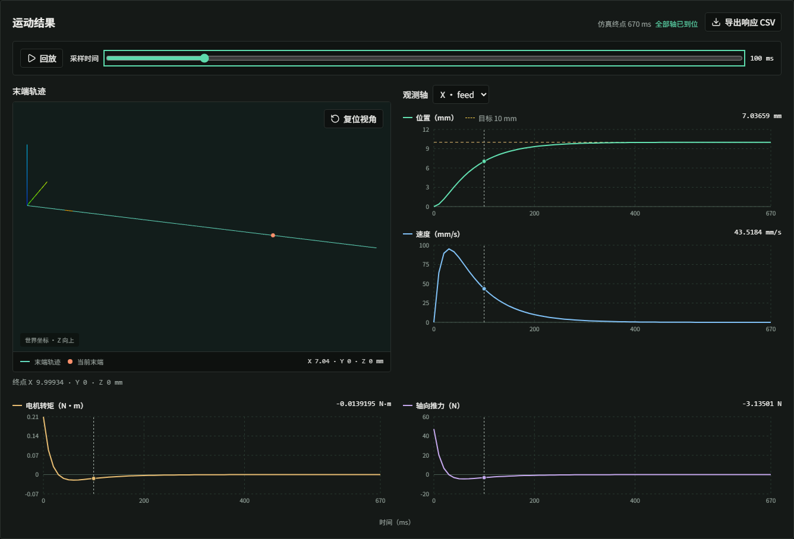

# 从 BOM 组装水平直线进给轴

输入 **+10 mm**，观察汇川伺服电机通过丝杠推动工作台。工程初始使用 5 mm/rev 丝杠和 5 kg 工作台，清单还含一根 10 mm/rev 备用丝杠和一个 20 kg 备用工作台。打开示例可以在独立工作区试跑，点 **加入当前工程** 可保存配置。[直接试跑](https://lusipad.com/omg/?view=workbench&example=modelica-feed-axis) · [预览并导入完整工程](https://lusipad.com/omg/?view=resources&source=assemblies/feed-axis/project.twin.json)

## 运行与换件

1. 在轴模块中核对四个角色。驱动器选择 SV660NS2R8I-FS-INT，电机选择 MS1H1-40B30CB-A331R-INT，丝杠和工作台分别选择 **5 mm 导程丝杠**、**5 kg 工作台**。完整工程已保存这些选择。
2. 保持 X 轴安装方向 **+X**、目标位移 **10 mm**，运行装配。将时间游标移到 **100 ms**，同时读取工作台位移、速度、电机转矩和轴向推力。三维回放显示末端在装配坐标系中的运动。导出响应 CSV 可以逐时刻比较结果。
3. 保持目标与工作台，再运行 **10 mm 导程丝杠**。完成 10 mm 进给所需的电机转数从两圈变成一圈。再恢复 5 mm/rev 丝杠，选择 **20 kg 工作台**，观察相同指令下的推力变化。
4. 恢复初始丝杠和工作台，将 X 目标设为 **−10 mm**。此时电机反转，位移、速度、转矩和推力的符号随之翻转。每次仿真均从静止零位开始。

下表取自 OpenModelica 1.27.2 原生 DASSL 的 **100 ms** 采样，电机与驱动器在四个工况中相同。

| 目标 | 丝杠导程 | 移动质量 | 工作台位移 | 进给速度 | 电机转矩 | 轴向推力 |
| ---: | ---: | ---: | ---: | ---: | ---: | ---: |
| +10 mm | 5 mm/rev | 5 kg | 7.03659 mm | 43.51835 mm/s | −0.013920 N·m | −3.13501 N |
| +10 mm | 10 mm/rev | 5 kg | 6.94661 mm | 50.78752 mm/s | −0.012373 N·m | −3.62458 N |
| +10 mm | 5 mm/rev | 20 kg | 6.94661 mm | 50.78752 mm/s | −0.024746 N·m | −14.49831 N |
| −10 mm | 5 mm/rev | 5 kg | −7.03659 mm | −43.51835 mm/s | +0.013920 N·m | +3.13501 N |

正向工况在 100 ms 时仍向前运动，此时驱动器已施加负转矩使工作台减速。表中第二、三行的毫米曲线很接近，因为两种换件都使折算到电机轴端的移动负载惯量变为初始值的四倍。两行的推力和电机转矩显示出机械配置的差异。



浏览器使用 0.05 ms 步长积分，每 10 ms 记录一次，另保留到位时刻。各轴同时计算，仿真程序每 1 ms 检查角度误差是否在 ±0.1° 内、转速是否在 ±0.5 rpm 内。全部轴连续满足 50 ms 时结束，最长观察 8 s。5 mm/rev 与 10 mm/rev 的丝杠分别把 0.1° 对应为 0.00139 mm 和 0.00278 mm。初始配置 670 ms 达到判据。[浏览器模型清单](https://lusipad.com/omg/modelica/runtime/feed-axis.json)

## 在自己的工程中逐件装配

1. 在 **工程资源 → 选择文件** 导入 BOM。每行给出数量与计件单位，丝杠行另给每转导程，工作台行另给随轴平移的总质量。表头采用 `导程(mm/rev)` 和 `移动质量(kg)`。[下载 BOM](https://lusipad.com/omg/assemblies/feed-axis/bom.csv)
2. 从同一入口安装设备包，核对物料与已安装修订的绑定。若已有多个同型号修订，可在该行 **查看与绑定** 中选择。汇川驱动器和电机沿用旋转伺服轴的 `v0.6-modelica.1` 修订。四个机械部件的来源字段均标明教学设计参数。

   | BOM 角色 | 独立设备包 |
   | --- | --- |
   | 驱动器与电机 | [SV660N 驱动器](https://lusipad.com/omg/modelica/devices/SV660NS2R8I-FS-INT.device.json) · [MS1 电机](https://lusipad.com/omg/modelica/devices/MS1H1-40B30CB-A331R-INT.device.json) |
   | 理想丝杠 | [5 mm/rev](https://lusipad.com/omg/assemblies/feed-axis/screw-5.device.json) · [10 mm/rev](https://lusipad.com/omg/assemblies/feed-axis/screw-10.device.json) |
   | 移动工作台 | [5 kg](https://lusipad.com/omg/assemblies/feed-axis/table-5.device.json) · [20 kg](https://lusipad.com/omg/assemblies/feed-axis/table-20.device.json) |

3. 导入装配关系，或在 **装配与仿真 → 新建装配 → 直驱丝杠伺服轴** 中选取这四行物料。在样例中，模块 `feed` 将它们连接成一根轴，X 轴引用这个模块，目标位移为 10 mm，整轴模型固定为 `GouyuanLinear.FeedAxis` 1.0.0。BOM、六个设备修订和装配关系都可以随工程 JSON 导出并重新打开。[下载装配关系](https://lusipad.com/omg/assemblies/feed-axis/assembly.json) · [下载已装配工程](https://lusipad.com/omg/assemblies/feed-axis/project.twin.json)

## 力和转矩怎样进入模型

`Gouyuan.PositionDrive` 根据位置与转速反馈给出电流指令，`Gouyuan.RatedTorqueMotor` 提供平均电机转矩。电机轴连接 `Gouyuan.IdealLeadScrew` 的旋转法兰，丝杠的平动法兰通过力传感器连接标准库 `Modelica.Mechanics.Translational.Components.Mass`。控制整定沿用旋转伺服轴的参考设置。丝杠的导程与工作台质量进入实际连接的部件方程。[进给轴源码](https://lusipad.com/omg/modelica/GouyuanLinear.mo) · [驱动、电机及丝杠源码](https://lusipad.com/omg/modelica/Gouyuan.mo) · [电机额定值与整定假设](Modelica伺服轴.md#设备规格与模型假设)

以米/转为单位取导程 `p`，以弧度为单位读取电机转角 `θ`，丝杠位移 `x = θ × p / (2π)` 的单位是米。模型中的轴向推力 `F = m × a` 作用在工作台上，传给丝杠的转矩为 `F × p / (2π)`。电机总转矩还包含加速转子所需的 `J × α`。教学工况假设水平刚性直驱、丝杠无损。核对实体机床的响应还需实测摩擦、间隙、工艺外力和控制整定。

## 对照原生采样

在 Ubuntu 24.04 amd64 或相应的 WSL 环境，按伺服轴教程加载 OpenModelica 1.27.2、MSL 4.0.0 与 Clang/LLD 18.1.3。然后从仓库根目录运行以下命令。[工具链安装与环境设置](Modelica伺服轴.md#用-openmodelica-原生复算)

```bash
python3 scripts/modelica/verify-feed.py --omc omc --out /tmp/gouyuan-feed-check
python3 scripts/modelica/build-web.py --check
node scripts/modelica/compare-web.mjs /tmp/gouyuan-feed-check feed
```

原生脚本保留各工况完整 8 秒的 801 个采样点，并分别核对工作台推力、丝杠传递转矩、转子力矩及功率平衡。最后一步用相同工况重新运行发布的 WebAssembly，逐点比对工作台位移与速度、电机转矩、轴向推力以及电机转角和转速，误差写入 `feed-web-comparison.json`。[原生工况记录](../scripts/modelica/feed-native-results.json)

要单独复算本页中 **20 kg 工作台** 的一行，可以用同一 MOS 编译模型后指定该质量。在仓库根目录、已经加载上述环境的终端运行下列命令，结果文件中 `time = 0.1` 的一行就是表中读数。

```bash
modelica_root="$PWD"
feed_run="$(mktemp -d)"
cp public/modelica/{Gouyuan,GouyuanLinear}.mo "$feed_run/"
cd "$feed_run"
omc "$modelica_root/scripts/modelica/check-feed.mos"
./GouyuanLinear.FeedAxis -noEventEmit -override=targetMm=10,leadMmPerRev=5,tableMassKg=20 -r=table20.csv
```
