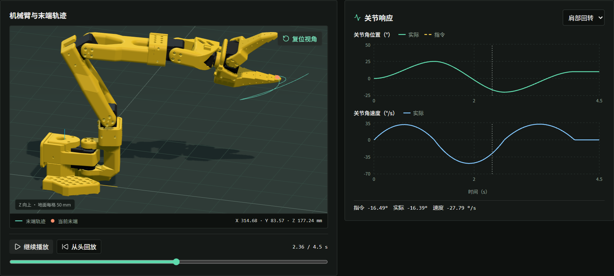

# 从官方 BOM 运行 SO-101 从臂

可从示例库直接打开三关键帧动作，或在当前工程中从采购表开始装配。本机运行可在项目根目录执行 `npm ci` 和 `npm run dev`。官方机器人模型、网格和 MuJoCo 浏览器引擎由本项目提供。[试跑 SO-101 从臂](https://lusipad.com/omg/?view=workbench&example=so101-follower) · [本机工程中的从臂](http://127.0.0.1:3000/twin?view=workbench&target=so101)

## 运行第一段动作

1. 在 **工程资源** 选择单从臂采购表或上游完整 README。也可以从工程的 SO-101 工作台点 **导入官方采购表**。核对预览后点 **导入 SO-101 BOM**，导入器读取 **Parts for One Follower Arm** 小节。[单从臂采购表](../public/models/so101/follower-bom.md)
2. 展开 **查看装配清单** 可核对 6 个 Feetech STS3215 舵机，规格为 7.4 V、1/345、C001。已知从臂模板把这六个执行机构分别绑定到肩部回转、肩部俯仰、肘部屈伸、腕部俯仰、腕部旋转和夹爪开合。桌夹或螺丝刀等辅助件的采购差异单独列为提示。[官方 BOM](https://github.com/TheRobotStudio/SO-ARM100/blob/a758567c3978dfeefe282ede0500085a48fe8f78/README.md#parts-for-one-follower-arm)
3. 首次导入采购表会得到一个 1 秒的六轴零位保持点。在 **编辑动作关键帧** 中设置到达时间和六个目标角度，等待模型编译后点 **运行动作**。示例库中的从臂从零位静止起步，依次在 1.2、2.6、4.0 秒到达三个指令姿态，末帧指令再保持 0.5 秒。执行器受重力、惯量、摩擦和模型力矩上限影响，实际角度可与指令存在跟踪误差。
4. 拖动回放时间条，使三维姿态、夹爪末端坐标、关节角和角速度停在同一时刻。在 **观察关节** 中切换六个执行机构。打开 **编辑动作关键帧** 后，可修改某一时刻的六个目标角度，再次运行比较结果。
5. 用 **工程文件 → 导出工程 JSON** 保存 BOM、模型修订和动作。导入[完整示例工程](../examples/so101-follower.twin.json)可以直接恢复这些输入，重新运行即可重算轨迹。

## BOM 和模型各提供了什么

| 输入 | 在这个示例里的作用 |
| --- | --- |
| 单从臂 BOM | 核对舵机型号、减速比、数量与配套采购物料。舵机配置不符时会指出具体原因 |
| 官方新标定 MJCF 场景 | 提供连杆层级、关节轴线、坐标、惯量、重力、位置执行器与碰撞几何。MuJoCo 用它计算运动 |
| 官方 STL | 提供 13 种不同的网格。相同舵机网格可用于多个可视件，网格种数与采购数量的含义不同 |
| 动作关键帧 | 每一行给出从起点累计的秒数，以及按界面顺序排列的六个目标角（°） |

模型固定为 The Robot Studio 与 Hugging Face 项目的提交 `a758567c3978dfeefe282ede0500085a48fe8f78`。MuJoCo 使用官方 `scene.xml` 和 `so101_new_calib.xml`。同一份目录也包含上游 URDF，可供其他机器人软件读取。[随附资源说明与许可](../public/models/so101/SOURCE.md) · [上游标定与仿真说明](https://github.com/TheRobotStudio/SO-ARM100/blob/a758567c3978dfeefe282ede0500085a48fe8f78/Simulation/SO101/README.md)

## 读数口径

位置曲线区分关节角指令和物理引擎计算的实际角度，速度单位为 °/s。末端轨迹取官方 `gripperframe` 工具坐标系原点在仿真世界中的位置，界面将米换算为毫米。该点固定在夹爪本体上。其他关节姿态相同时，单独转动活动夹片不会改变这个工具点的坐标。

夹爪在官方模型中使用转动关节，界面同样使用角度。实机 LeRobot 的 `0–100` 开合指令还需要对应的行程标定。此样例展示固定从臂装配的物理响应，其他型号或自改结构需要相应的连杆和关节模型。[官方夹爪说明](https://github.com/TheRobotStudio/SO-ARM100/blob/a758567c3978dfeefe282ede0500085a48fe8f78/Simulation/SO101/README.md#gripper-note)

内置动作从零位开始，MuJoCo 按模型的 2 ms 步长推进，工作台每 20 ms 记录一帧。下表是这一动作的模拟末端坐标，可以用回放游标复核。

| 仿真时间（s） | X（mm） | Y（mm） | Z（mm） |
| ---: | ---: | ---: | ---: |
| 0.0 | 391.36 | −0.01 | 226.47 |
| 1.2 | 324.46 | −135.46 | 226.99 |
| 2.6 | 305.82 | 100.03 | 172.96 |
| 4.5 | 362.42 | −58.46 | 228.13 |

下图为内置动作在 2.36 s 时的工作台画面。橙点是夹爪工具坐标系原点，青线是本次运动的末端轨迹。右侧游标给出同一时刻肩部回转的实际角度和速度。

