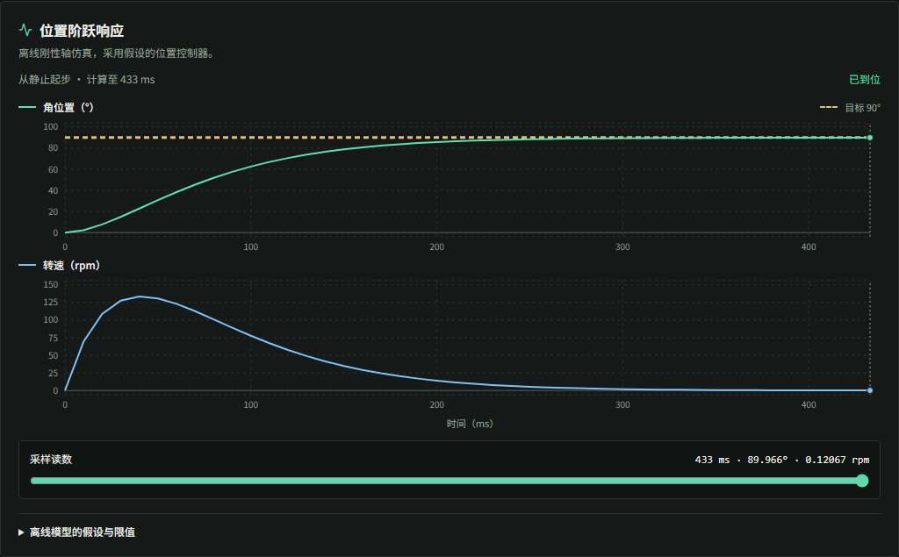

# 用两份汇川设备资料组一根伺服轴

本例使用 SV660NS2R8I-FS-INT 驱动器和 MS1H1-40B30CB-A331R-INT 无抱闸电机，模拟电机轴从静止零位转到指定角度。输入使用角度（°），速度读数使用转/分（rpm）。[试跑汇川伺服轴](https://lusipad.com/omg/?view=workbench&example=inovance-servo)

## 从官网链接生成两个设备包

本机生成可用 `npm run dev:servo` 启动。它使用本机已经登录 ChatGPT 的 Codex CLI，并需要 `pdftotext` 读取 PDF 选型表。也可以在本项目的 `.env.development.local` 中设置 `TWIN_LOCAL_CODEX=1`，使普通 `npm run dev` 启用这一入口。点击生成后，工作台会将订货号、相关表头、匹配行和编码脚注发给模型。生产部署使用原平台登录及服务端 `TWIN_AI_*` 配置。

1. 在完整版 **工程资源 → 创建设备 → 从官网创建配套伺服设备** 中填入驱动器和电机的官网链接。页面也提供这组链接。[驱动器产品页](https://www.inovance.com/global/content/details_816_555207.html) · [电机产品页](https://www.inovance.com/global/content/details_816_555691.html)
2. 发起 AI 生成。服务读取两个型号的资料，并用官方选型表的同一行核对配套关系和参数单位。对于本例，选型表中的电机代码含选项占位符，`yn=A3` 对应编码器版本，`z=1` 对应有油封、无抱闸。该行给出的是无抱闸转子惯量。[SV660N 官方选型表，第 3 页](https://www.inovance.eu/fileadmin/downloads/Brochures/EN/SV660N_FIyer_Spreads_Web_EN_v0.6.pdf#page=3)
3. 核对两个草案后一起安装。两个型号可分别导出、再次导入和独立选取。手头已有设备包时，在 **工程资源 → 选择文件** 可以一并导入，再打开工程中的伺服轴。[驱动器设备包](../examples/SV660NS2R8I-FS-INT.device.json) · [电机设备包](../examples/MS1H1-40B30CB-A331R-INT.device.json)
4. 在 **组装单轴** 中选择这两个已安装的型号，输入目标 `90` 和负载惯量比 `1`，再点 **组轴并运行位置阶跃**。位置图的虚线是目标值，两张图使用同一时间轴。可用时间游标读取同一时刻的位置与速度。将目标改为 `-90` 可以观察反向运动。

如果想先看曲线，从 **示例库 → 汇川伺服轴** 打开即可运行。想保留试跑后的配置，可点 **加入当前工程**。要恢复一份完整存档，在 **工程文件** 中选择导入并核对替换范围。[完整示例工程](../examples/inovance-servo-axis.twin.json)

本版自动核对汇川 SV660N 与 MS1 系列在该版选型表中的配套行。提供系列级链接时可在页面指定完整订货号。表中仅列无抱闸转子惯量，带抱闸型号需要其专用惯量资料；其他系列或表格版式需要相应的字段和单位映射。

## 哪些数值来自资料

| 设备 | 已核对参数 |
| --- | --- |
| SV660NS2R8I-FS-INT | 驱动器额定输出电流 2.8 A，峰值输出电流 10.1 A |
| MS1H1-40B30CB-A331R-INT | 400 W，额定与峰值转矩分别为 1.27、4.45 N·m，额定与最高转速分别为 3000、7000 rpm |
| 电机转子 | 无抱闸惯量 0.145 × 10⁻⁴ kg·m²，设备包使用 SI 数值 0.0000145 kg·m² |

这些数值和配套关系均可用包中保留的资料定位和摘录复核。选型表中的 2.8 A 属于驱动器，电机另册的额定电流为 2.5 A。本例的电机包取自选型表，省略电机额定电流，仿真采用已配对驱动器能够供给额定转矩的假设。[汇川 MS1-R 电机样本，第 5 页](https://portal-file.inovance.com/owfile/ProdDoc/CY/19120516-CY/A00/19120516-CY_A00%E3%80%8AMS1-R-INT%20Series%20Servo%20Motor%20Brochure-EN%E3%80%8B20241230_Web.pdf#page=5)

## 如何理解响应曲线

轴采用刚性转动模型。电机转子与折算到电机轴端的负载共同决定总惯量。位置误差和速度反馈产生转矩指令，转矩、功率与转速受到连续额定值限制。引擎每 1 ms 积分，每 10 ms 记录一次绘图样本，同时保留最后一步。每次运行从静止零位开始。

控制增益是工作台设定的仿真参数。模型在负载惯量比为 1 时采用 24 rad/s 自然角频率的临界阻尼配置，修改负载后保留同一套增益。位置误差不超过 0.1°、速度绝对值不超过 0.5 rpm，连续满足 50 ms 后报告到位。仿真最长运行 8 s。

| 目标位置 | 负载惯量 / 转子惯量 | 判定到位时刻 | 此时位置 | 采样速度峰值（带方向） |
| --- | ---: | ---: | ---: | ---: |
| 90° | 1 | 433 ms | 89.966° | 133.47 rpm |
| −90° | 1 | 433 ms | −89.966° | −133.47 rpm |
| 90° | 5 | 923 ms | 90.061° | 106.13 rpm |

上述数值是示例工程的离线仿真结果。实机响应还取决于驱动器整定、实际负载、摩擦、传动柔性、采样和电流环延迟，比较实测轨迹时需单独标定。[仿真模型实现](../contracts/servo-axis.ts)
