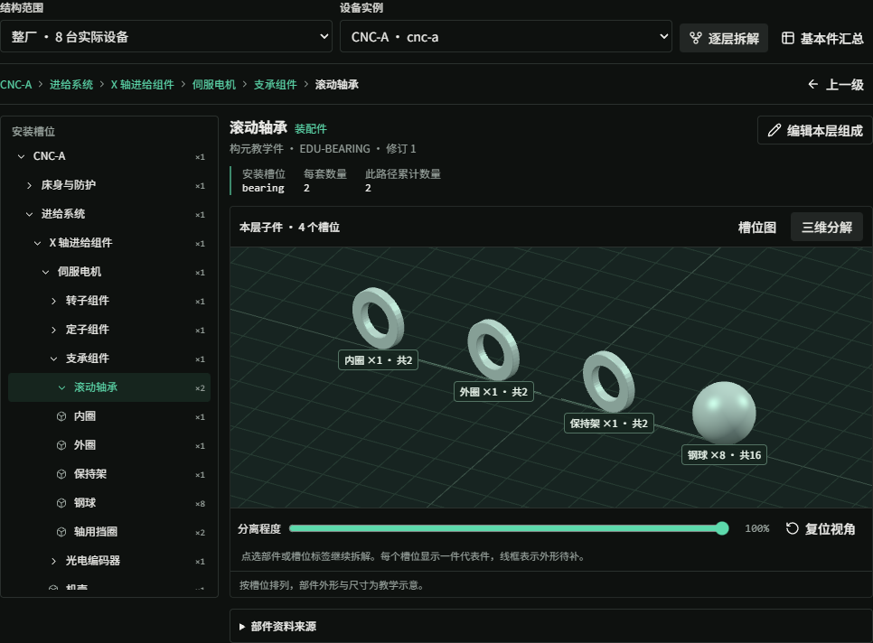

# 从工厂设备拆到单个零件

打开双线数控车间，在 **设备结构** 中选择设备实例。设备树按安装槽位逐层展开，最小件保留制造商、型号、修订和资料来源。本例的整机与零部件均为构元教学设计，内部结构和数量可用随附清单核对。[直接拆解 CNC-A](https://lusipad.com/omg/?view=workbench&example=cnc-factory&structure=cnc-a) · [打开完整工程预览](https://lusipad.com/omg/?view=resources&source=assemblies/cnc-factory/project.twin.json)

## 拆开 CNC-A 的 X 轴

1. 选择 **CNC-A**，依次进入 **进给系统 → X 轴进给组件 → 伺服电机**。
2. 进入 **支承组件 → 滚动轴承 → 钢球**。这台电机有一套支承，支承内有两只轴承，每只轴承有八颗钢球。这条路径的用量为 **16 颗**，对应的最小件型号是 `BALL-4`，修订为 `1`。
3. 用 **上一级** 或路径导航回到这台电机。进入 **转子组件 → 永磁体** 可看到四块磁体，进入 **定子组件 → 三相绕组线段** 可看到三段漆包线。相同型号出现在其他位置时，仍可沿各自的路径核对数量。

在有子件的层级可切换到 **三维分解**，拖动改变视角，用 **分离程度** 拉开本层的子件，点选形体或它的标签继续下钻。每个槽位显示一个代表件和安装数量。形体按教学示意排列，安装尺寸和方向须以设备图纸为准。



移动机器人可沿 **移动底盘 → 差速牵引组件 → 左右驱动电机** 展开。上下料设备可沿 **上下料臂总成 → 关节驱动 → 关节伺服电机** 展开。输送带可沿 **输送托辊 → 托辊轴承 → 钢球** 展开。这些路径复用了同一修订的电机或轴承。

## 汇总整座工厂

打开 **基本件汇总**，在 **汇总范围** 中选择整厂，也可以只查看当前设备或当前节点。每个槽位的数量沿路径相乘，同一最小件跨设备的用量再相加。点击 **导出用量 CSV** 可保存结果。

| 已安装设备 | 实例数 | 每台最小件数 | 安装用量 |
| --- | ---: | ---: | ---: |
| 上下料设备 | 4 | 411 | 1,644 |
| 输送机 | 1 | 229 | 229 |
| 移动机器人 | 1 | 350 | 350 |
| 数控机床 | 2 | 747 | 1,494 |
| 合计 | 8 | | **3,717** |

基准布局共用到 **67 种最小件**，其中 `BALL-4` 钢球一共 **688 颗**。两条产线共享同一台移动机器人，工厂结构计入一台。采购清单另外列有可供换型的整机，用量汇总按实际放置的设备计算。[原始整机采购清单](../public/assemblies/cnc-factory/bom.csv) · [设备实例与产线布局](../public/assemblies/cnc-factory/layout.factory.json)

同一槽位的多件默认共用同一修订。要只换 X 轴电机两只轴承中的一颗钢球，先在 **支承组件** 的组成编辑器里将两只轴承 **拆出 1 件** 并保存。进入刚拆出的单个轴承，再把钢球槽位拆出一件。原钢球槽位留七颗，新槽位有一颗，可以单独选择修订。只给这颗球另存检验备注后，整厂 CSV 中原修订有 **687 颗**、新修订有 **1 颗**，总数仍为 3,717 件。

## 只更换输送带的驱动组件

1. 选择 **主线输送带** 整机 `CELL-BELT-100` 修订 `2`。输送模型从安装槽 `drive` 中读取 `lineSpeed`，单位是 m/s。原驱动 `BELT-DRIVE-100` 的标定值为 1。
2. 在整机的 **编辑本层组成** 中找到 `drive` 槽，在 **子件型号与修订** 中选 `BELT-DRIVE-200` 修订 `1`。它的标定值为 2。给根设备填写新的修订号，例如 `2-fast`，再点 **保存结构新修订**。
3. 重新运行工厂。在时间线 CSV 中观察主线第 1 件的输送区间。两次都在 **4 s** 上带，原驱动在 **8 s** 抵达接驳位，快驱动在 **6 s** 抵达。更早到达的工件改变了共享车辆与机床的派工顺序，9 件的整批时间由 **324.50 s** 变为 **328.08 s**。本次换件后的 33 条记录与直接选择快型输送机逐项一致。

设备包把需要参与求解的参数与具体槽位、子件额定值及单位关联。CNC-B 从其 X 轴的 `nominalFeed` 取得工艺进给。只把这根 X 轴从 `FEED-AXIS-900` 换为 `FEED-AXIS-600`，同一段 450 mm 刀程的含装夹周期由 36 s 变为 51 s，整批完成时间为 **339.30 s**。本例中的轴承、螺钉等条目用于核对装配与用量。实体设备的摩擦、刚度、寿命和校准参数需要相应的物理模型与资料。

## 单独导入部件

示例设备库有八种整机型号和 105 种子件修订。直接导入完整设备库可一次安装所有根和依赖。也可先装所需的整机设备包，再导入共享子件库。标准工程导出会保存实际选用的修订，**导出结构设备库** 可以把所选设备连同其子件带入其他工程。[完整设备库](https://lusipad.com/omg/assemblies/cnc-factory/devices.library.json) · [共享子件库](https://lusipad.com/omg/assemblies/cnc-factory/parts.library.json) · [CNC-A 整机设备包](https://lusipad.com/omg/assemblies/cnc-factory/devices/cnc-cycle.device.json)

整机修订 `1` 和 `2` 可以共存。修订 `2` 的采购记录将来源标为 **双线数控车间教学设计 · 整机修订 2**。在已经安装两种修订的工程里单独导入采购 CSV 时，请在 **查看与绑定** 中明确选用哪个修订。完整工程 JSON 保存了每行的实际绑定。

安装槽引用完整的制造商、型号和修订。最小件的边界由设备资料指定，例如本例按单个电子封装、密封电芯、预裁线段或独立成形件计量。供应商尚未提供内部组成时，界面显示 **待补明细**。若槽位引用了尚未安装的修订，则提示补装对应设备包。两种状态都会在汇总中显示。

## 给自己的设备定义层级

在已安装设备的详情中编辑组成，或通过统一导入入口载入设备包 JSON。父设备用 `composition.parts` 列出直接子件。下例表示这套支承内有两个相同修订的轴承，工作台会继续读取轴承设备包中的组成。

```json
{
  "kind": "assembly",
  "parts": [
    { "id": "bearing", "label": "滚动轴承", "packageKey": "[\"构元教学件\",\"EDU-BEARING\",\"1\"]", "quantity": 2 }
  ]
}
```

在达到建模边界的设备包中写入 `"composition": {"kind": "leaf"}`。没有内部分解资料时可省略整段 `composition`。每个槽位可以重复使用同一子件定义。若只替换成组零件中的一件，可用 **拆出 1 件** 再换型。保存时会为这条路径及其父件派生新修订。

一个工程可保存 512 种设备修订。层级按安装槽逐级展开，用量由每层的整数数量累乘。同一修订在多台设备、多个槽位中复用时，设备库只需安装一次，汇总时会计入所有实际用量。

要把当前装机配置交给另一人，可使用工厂的 **导出 → Modelica 工程 ZIP**。`factory.twin.json` 保存已装设备及其下层依赖，`parts-bom.csv` 保存用量。接收方可以把原 ZIP 直接导入工作台，或者在 OpenModelica 中运行随包的 `run.mos`。需要一并保存工程里的备用设备时，可用 **工程文件 → 导出工程 JSON**。
