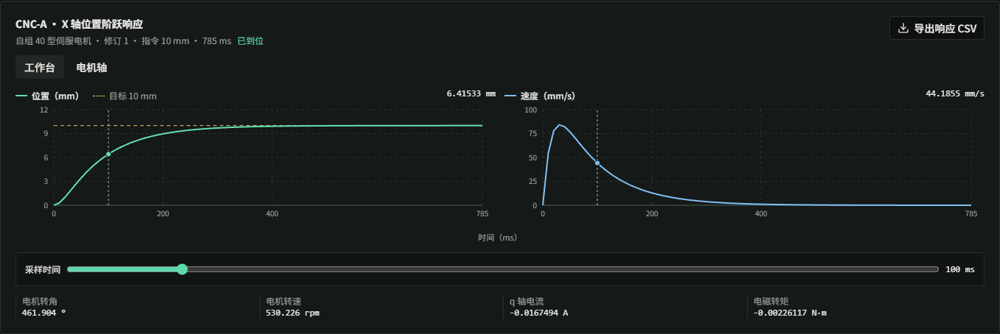

# 从定子、转子和轴承装出 CNC 的 X 轴电机

在双线数控车间打开 CNC-A 的电机调试入口，分别选定子、转子和一对轴承，给自组电机一个型号与修订号。装进 X 轴后，毫米指令会驱动这台电机、丝杠和工作台。初始装机的 `EDU-SERVO @ 1` 保存了结构明细，示例库另备六种有电磁或阻尼参数的教学零件。[打开 CNC-A 电机装配与试跑](https://lusipad.com/omg/?view=workbench&example=cnc-factory&motorAxis=cnc-a)

要用刚装好的电机铣圆槽，先把这份装机保存到当前工程，再到三轴工作台沿用 X 轴的电机修订。[打开 CNC-A 三轴加工](https://lusipad.com/omg/?view=workbench&example=cnc-factory&contour=cnc-a) · [圆槽程序与实算结果](CNC三轴圆槽.md)

## 第一次运行

1. 在 **电机与轴 → 轴安装位** 中选 **CNC-A** 和 **X 轴**。组装电机时，定子选 `S40-STD`，转子选 `R40-STD`，轴承选 `B08-STD`。一台电机使用一个定子、一个转子和两只同修订轴承。在选件表的来源区域可核对各自的参数、单位与配合接口。
2. 输入电机制造商、型号与修订，例如 **工程自建 / X 轴教学电机 / 1**，点击 **组装并存入设备库**。这个电机包记录三个安装槽位及精确的零件修订，可用于同接口的其他轴。
3. 在 **待装电机** 中选刚组好的电机，核对 **机床新修订** 后点 **装到当前轴**。工厂装配树中的位置是 **CNC-A → 进给系统 → X 轴进给组件 → 伺服电机**。
4. 输入 **10 mm**，点击 **运行位置指令**。查看工作台位置和进给速度曲线，再切换到 **电机轴** 可看转角与转速。时间游标初始定位到 **100 ms**，标准组合约为 **6.41533 mm、44.18550 mm/s**，电机转过 **461.90°**，转速约 **530.23 rpm**。**导出响应 CSV** 可保留六个通道的逐点读数。
5. 将目标改为 **−10 mm** 重跑，可观察反转。每次试跑都从零位、静止和零电流开始。要保存试用中选定的型号、装机路径和指令，点击 **加入当前工程**。



## 从空工程开始，先把电机收入自己的设备库

1. 在 **工程资源** 导入独立电机零件库，核对并安装。它包含六个可选组件和九种基础件修订。搜索 `S40-STD`，在设备详情点击 **用于组装电机**，选件表会带入这个定子。也可从 **创建设备 → 从部件组装电机** 进入。[下载电机零件库](https://lusipad.com/omg/assemblies/motor-kit/components.library.json)
2. 选好转子和轴承，填写新的电机身份，点击 **核对组装电机 → 确认安装**。现有工程可在电机详情点 **安装到机床轴**。空工程可以先点 **浏览示例库**，打开数控工厂并选择 **加入当前工程**，自组电机会随原工程保留。[打开数控工厂示例](https://lusipad.com/omg/?view=workbench&example=cnc-factory)
3. 从 **工程资源** 打开自己的电机详情，点 **安装到机床轴**，选择 **CNC-A**。核对 **待装电机**，执行本页的安装与试跑步骤。**下载电机和子件** 可导出独立设备库，本例标准电机含一个电机总成、三种选中的组件和九种下层修订。两只轴承共用一份轴承定义。

本车间的两种 CNC 在修订 3 上声明了 X 轴安装位，其余六种整机沿用修订 2。**确认替换工程** 用于恢复独立的完整存档。[预览带 CNC 的完整工程](https://lusipad.com/omg/?view=resources&source=assemblies/cnc-factory/project.twin.json)

## 同一条指令，逐次只换一个零件

下表取自 OpenModelica 1.27.2 的原生 DASSL，均为从零位进给 **10 mm** 后的 **100 ms**。每换一种配置就创建一个新的电机修订，将它安装在同一个 CNC-A 的 X 轴，保持控制整定、丝杠和负载一致。

| 选件变化 | 工作台位置 mm | 进给速度 mm/s | 电机转速 rpm | q 轴电流 A | 电磁转矩 N·m |
| --- | ---: | ---: | ---: | ---: | ---: |
| `S40-STD`、`R40-STD`、两只 `B08-STD` | 6.41533 | 44.18550 | 530.226 | −0.016749 | −0.002261 |
| 定子改为 `S40-HL`，q 轴电感从 4 增至 12 mH | 6.42293 | 44.12708 | 529.525 | −0.017316 | −0.002338 |
| 转子改为 `R40-HI`，转动惯量从 2 × 10⁻⁵ 增至 6 × 10⁻⁵ kg·m² | 5.68742 | 61.05818 | 732.698 | −0.131463 | −0.017747 |
| 两只轴承改为 `B08-HI`，每只粘滞系数从 0.00012 增至 0.00036 N·m·s/rad | 5.47480 | 40.76795 | 489.215 | +0.194216 | +0.026219 |

标准组合在这一刻仍向前运动，电磁转矩已经反向制动。重转子组合到达的位置靠后，100 ms 时的瞬时速度较高。对照整条曲线可以区分某一时刻的速度、速度峰值与累计位移。标准组合在 **785 ms** 达到工作台的结束判据，即电机轴端的角位置误差在 ±0.1° 内、速度在 ±0.5 rpm 内连续保持 50 ms。[模型与端口定义](../public/modelica/motor-library.json)

## 哪些参数进入方程

| 参数来源 | 标准组合 |
| --- | --- |
| 定子 `S40-STD` | 每相电阻 2 Ω、q 轴电感 4 mH、每相串联 50 匝、基波绕组系数 0.9、绕组峰值电流指令上限 4 A、2 极对、定子内径 24 mm。 |
| 转子 `R40-STD` | 每极基波满距单匝峰值磁通 1 mWb、转动惯量 2 × 10⁻⁵ kg·m²、2 极对、转子外径 23 mm、轴承安装段直径 8 mm。 |
| 轴承 `B08-STD` | 内径 8 mm，每只等效粘滞系数 0.00012 N·m·s/rad。两只合计 0.00024 N·m·s/rad。 |
| CNC 的 X 轴调试定义 | 水平直驱，丝杠导程 5 mm/转，工作台移动质量 5 kg。q 轴电压幅值上限 24 V、电流指令上限 4 A、速度指令上限 2500 rpm，控制器参考惯量 4 × 10⁻⁵ kg·m²，电流环比例增益 8 Ω。 |

装配时核对 `EDU-FRAME-40` 接口、极对数、气隙和轴承安装直径。本例的名义径向气隙为 `(24 − 23) / 2 = 0.5 mm`。导程 5 mm/转意味着 10 mm 的最终目标对应电机两圈。实际安装精度还取决于轴向尺寸、配合公差、对中和预紧。

本例使用幅值不变的 q 轴约定，假设 `id = 0` 和理想位置反馈。定子匝数、绕组系数与转子磁通共同给出每相永磁磁链 `ψ = 50 × 0.9 × 0.001 = 0.045 Wb`。以机械角速度 `ω` 和极对数 `p` 计算反电势 `e = pψω`。定子求解 `Lq × diq/dt = vq − R × iq − e`，转子获得电磁转矩 `1.5 × p × ψ × iq`。峰值 q 轴电流以 A 计，绕组铜耗为 `1.5 × R × iq²`，轴承的粘滞损耗为 `数量 × 粘滞系数 × ω²`。这些是功率量，推算温升还需热容与散热条件。24 V 是模型给 q 轴的电压上限，4 A 是控制器的电流指令上限。[实际 Modelica 方程](../public/modelica/GouyuanMotor.mo) · [幅值不变变换下的电压和转矩公式](https://www.mathworks.com/help/simscape-electrical/ref/pmsmdq0.html)

这些额定值、工况和驱动整定均为构元教学设定。带入实际零件时，应按相同的峰值与单位口径提供可追溯资料。此模型计算电流、角位置和角速度，并经水平无损丝杠得到工作台的位置和速度。研究磁饱和、齿槽转矩、PWM 开关、实际轴承摩擦或温升，需要相应的测量参数和模型。

## 导出后复算

在轴试跑工作区点 **导出轴 Modelica ZIP**，解压后进入根目录。使用已安装标准库 4.0.0 的 OpenModelica 1.27.2 执行以下命令。

```bash
omc run.mos
```

`AssembledMotor.mo` 保存已装电机的参数，`MotorAxisRun.mo` 将这台电机装入相同轴工况。检查 `MotorAxisRun_res.csv` 的 `time=0.1` 行，时间单位为秒。参数映射 `motor-map.json` 记录每个值及其来源路径，`motor.library.json` 允许单独复用电机和子件，`installed.twin.json` 保存当前工厂的装机快照。将原 ZIP 导入工作台也可恢复这份配置。[原生编译与仿真 MOS](../scripts/modelica/check-motor.mos) · [装机归档复算记录](../scripts/modelica/motor-assembly-results.json)
